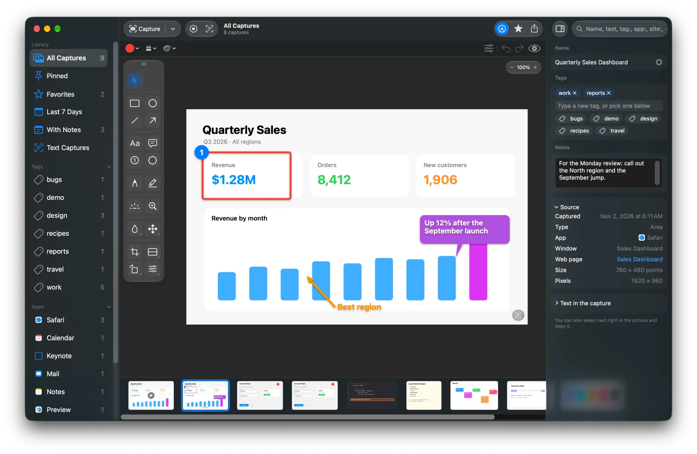
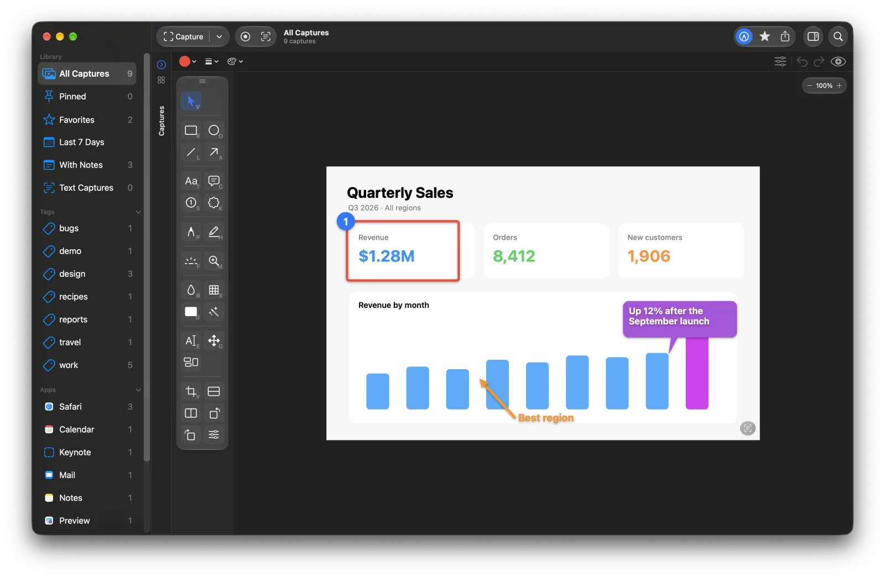
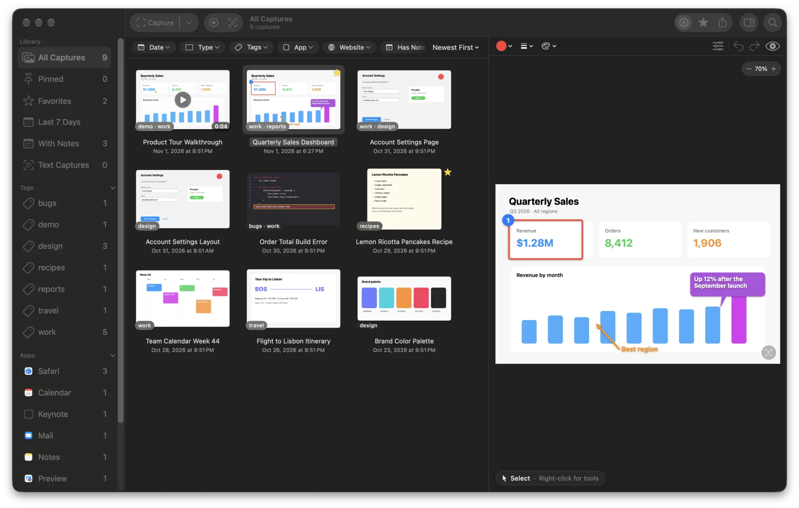
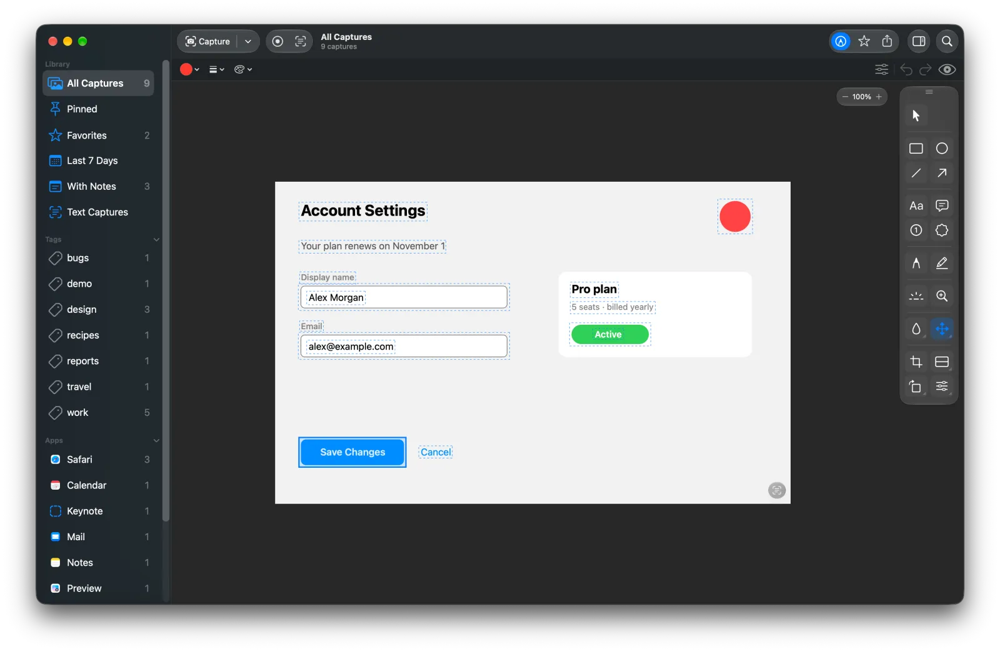
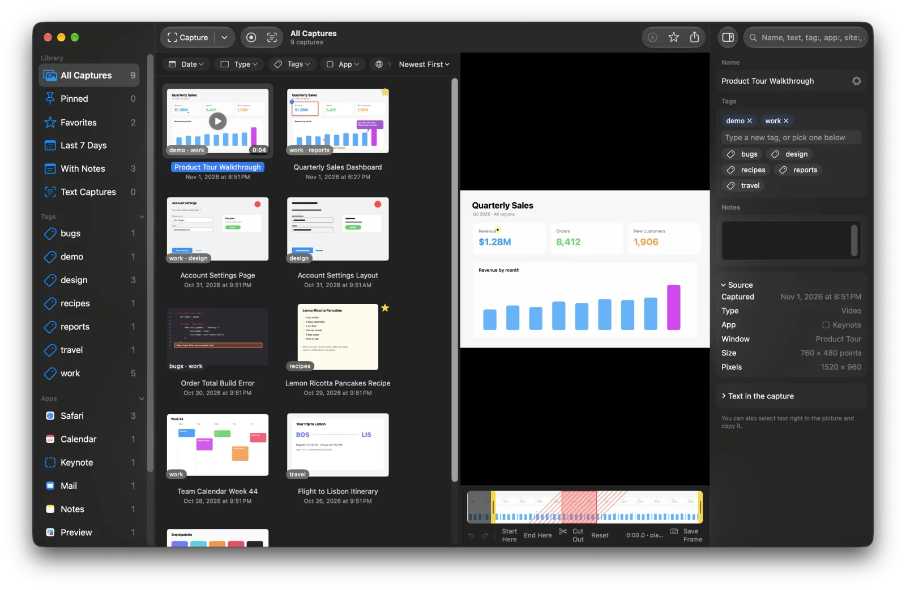
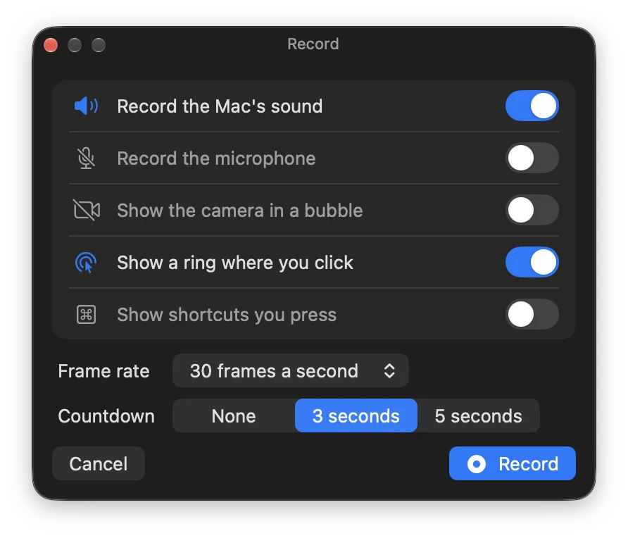
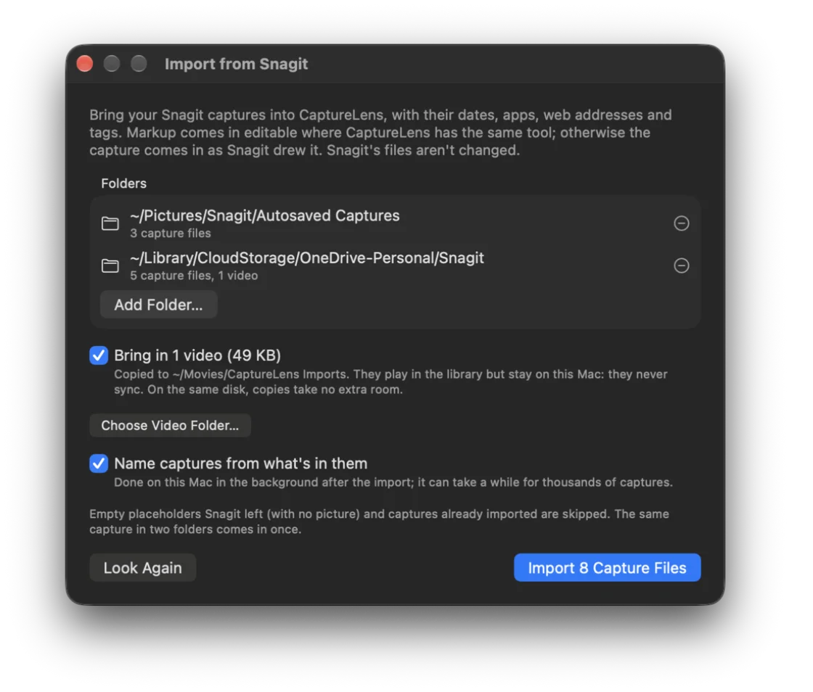

# SnagAnything

*Formerly CaptureLens. Copies of CaptureLens update to SnagAnything on their own, with their library, settings and permissions.*

Screenshots pile up on the Desktop with names like "Screenshot 2026-10-24 at 13.05.12", and finding the one you
need means opening them one by one. SnagAnything keeps every capture in a library instead. Each capture is
named from what's in it ("Quarterly Revenue Chart", "Xcode Build Error") by Apple Intelligence on your Mac, and
you can find it again by its name, the date, its tags or notes, or any text that appears in the picture.

<p align="center"></p>

SnagAnything also:
- **Captures** the whole screen, one window (even where others cover it), an area you drag out, or a frame of an
  exact size, now or after a countdown, each from its own preset and shortcut.
- **Records video** of the screen, a window or an area, with the Mac's sound, your microphone, your camera in a
  round bubble, rings where you click and the shortcuts you press, at 10 to 60 frames a second, all switched on or
  off in a panel before you record (with a choice of microphone, camera and countdown). Pause and resume, trim the ends, cut sections
  out of the middle, save a frame as a picture, and save as MP4 or an animated GIF.
- **Captures long pages** by stitching a scrolling area into one tall picture, and **records how-tos**: a
  capture at every click, each step numbered and named from what you clicked, ready to become a guide.
- **Makes guides**: lay captures out as a step-by-step guide, reference sheet or timeline, as a PDF or picture,
  and export many captures at once with the same format, size and frame.
- **Keeps the pointer separate**, so you can show, hide, move or resize it after the capture.
- **Marks captures up** with boxes, arrows, text, callouts, numbered steps, a pen, a highlighter, a spotlight, a
  magnifier and stamps, in any color and size. The marks stay separate from the picture, so they can be moved,
  resized or edited any time, and copying or saving draws them in. The tools sit in a strip beside the picture
  or in a dial around the pointer, grouped by kind: every tool in its group's slice, or one button per group.
- **Adjusts captures without touching the original**: crop, rotate, resize, cut strips out with torn or wavy
  seams, add borders, shadows and torn or faded edges, remove the background, and blur or black out anything
  sensitive, which Smart Redact finds for you (emails, phone and card numbers, keys and more). Save as PNG, JPEG,
  HEIC, TIFF, GIF, BMP or PDF.
- **Edits what's in the picture**: retype text in a matching font, size and color, pick up buttons, icons and
  lines of text and move them elsewhere (the spot they leave is filled in), or simplify the whole picture into
  plain shapes to show a layout without its details.
- **Lets you select and copy text** right in the picture, with macOS's own Live Text.
- **Captures text**: press ⌥⇧⌘T and drag over any text on screen, even in a picture, a video or a PDF, and it's
  copied, ready to paste. The picture is kept in the library too, with the copied words along its thumbnail.
- **Organizes** with tags, favorites and notes, and filters by date, type, tag, app or website in
  one click.
- **Lays out the library your way**: drag the line between the captures and the picture, hide the picture or the
  details (⌥⌘2, ⌃⌘I), show the picture full width with the captures in a strip under it (⌥⌘1, Esc to go
  back), and open a capture beside the captures, full width or in a window of its own. The layout follows you to
  your other Macs as proportions, so it fits each screen.
- **Remembers where a capture came from**: the app, the window, and in a browser, the web page.
- **Brings your old library along**: Import from Snagit moves Snagit captures in with their dates, apps, web
  addresses and tags, and their markup editable where SnagAnything has the same tool. Videos can come too.
- **Collects captures from other tools**: turn on macOS screenshots or Snagit captures, and new ones come into
  the library as you take them, so it has everything whatever you capture with. The original files stay put.
- **Shows your activity**: Settings › Activity graphs your captures by kind, with recording time, the apps and
  websites you capture most, and how often you mark up and share, on this Mac or added up across all your Macs.
- **Keeps the library private**: encrypted on your Mac, optionally locked behind Touch ID, and synced between
  your Macs end-to-end encrypted through iCloud, or through a Dropbox, OneDrive or Google Drive folder. Settings
  and the library sync separately, each switched on or off on each Mac.

## Download

**[⬇ Download SnagAnything.dmg](https://github.com/smanke-org/SnagAnything/releases/latest/download/SnagAnything.dmg)**

1. Open the disk image and drag **SnagAnything** to **Applications**.
2. Open SnagAnything. Its icon appears in the menu bar.
3. Allow **Screen Recording** when asked (System Settings › Privacy & Security › Screen & System Audio Recording).
   SnagAnything needs it to capture the screen. Recording your voice or camera asks for the microphone or camera
   the first time you turn them on.

Requires macOS 26 or later. Automatic names need Apple Intelligence turned on.

## Screenshots

<table>
<tr>
<td width="50%"><br><sub><b>Markup.</b> Boxes, arrows, callouts and steps that stay editable.</sub></td>
<td width="50%"><br><sub><b>Strip or dial.</b> The tools as a dial, grouped by kind, pinned open.</sub></td>
</tr>
<tr>
<td width="50%"><br><sub><b>Smart Move.</b> Pick up parts of the picture and move them.</sub></td>
<td width="50%"><br><sub><b>Video editing.</b> Trim the ends and cut sections out.</sub></td>
</tr>
<tr>
<td width="50%" align="center"><br><sub><b>Record.</b> Sound, camera, clicks and countdown, set before you start.</sub></td>
<td width="50%" align="center"><br><sub><b>Import from Snagit.</b> Bring your old library along.</sub></td>
</tr>
</table>

## Use it

| Shortcut | What it does |
|---|---|
| ⌥⇧⌘4 | Capture: click a window, or drag over an area (Return for the whole screen) |
| ⌥⇧⌘3 | Capture the whole screen |
| ⌥⇧⌘5 | Capture a window |
| ⌥⇧⌘6 | Scrolling capture: pick an area, scroll, and it's stitched into one tall picture |
| ⌥⇧⌘R | Record a video (press again to stop) |
| ⌥⇧⌘T | Capture Text: copy the text in an area |
| ⌥⇧⌘L | Open the library |

Every capture goes into the library, and onto the clipboard if you like. A preview slides into the corner:
click it to open the capture, or drag it straight into another app. To open every capture in the library right
away, choose Open Captures in Library in the menu bar menu; hold ⌥ while clicking or dragging to open just one.

Presets are saved ways to capture, each with its own shortcut: what to capture, a countdown, an exact size, and
whether to copy. Make and change them in Settings › Presets.

In the library, the Capture button captures with your first preset (its arrow lists them all), and Markup, the
star and Share act on the selected capture, and the gear opens Settings; everything else is in the menus and the right-click menu. Search
finds words in names, tags, notes and the text in the pictures. It also understands
`tag:work`, `app:safari`, `site:example.com` and dates such as `yesterday` or `March 3`.

Actions can also be run from a URL, for ToolHUD, Shortcuts or scripts: `snaganything://capture`, `screen`,
`window`, `area`, `scrolling`, `steps`, `record`, `recapture`, `library` and `preset/<name>` (for example
`open snaganything://screen`).

### Command line and AI agents

SnagAnything is also a command line tool, so scripts and AI agents (Claude Code, Codex) can search the library,
read the text in captures, export, tag and rename them, and start captures. Commands run in the open app, and the
library window shows each change at once. Link it once to type `snag`:

```bash
ln -s /Applications/SnagAnything.app/Contents/MacOS/SnagAnything ~/.local/bin/snag
```

```bash
snag help
snag captures list --search invoice --json
snag captures export 3f2a9c1e --to ~/Desktop
```

Every command takes `--json`. Deleting only shows what it would delete until you add `--yes`, and a locked library
stays locked until you unlock it. For MCP apps such as Claude Desktop, the same commands are served by
`/Applications/SnagAnything.app/Contents/MacOS/SnagAnything mcp`:

```bash
claude mcp add --scope user snag -- /Applications/SnagAnything.app/Contents/MacOS/SnagAnything mcp
```

## Privacy

Naming captures and reading their text run entirely on your Mac. SnagAnything has no account, analytics or
tracking, and nothing is ever sent to the developer. The only connection it makes on its own is to GitHub, to
check for updates.

The library is encrypted on your Mac with AES-256, using a key kept in your keychain, and can require Touch ID
or your password to open. Sync is end-to-end encrypted: with "Sync with your other Macs" on (and its Settings and
Library choices, which each Mac sets for itself), your settings and library are sealed on your Mac before they reach iCloud, using a key that only your sync
passphrase unlocks. Neither Apple nor the developer can read what's synced. The library can sync through a
folder that Dropbox, OneDrive, Google Drive or another sync app keeps on your Macs instead (Settings › General);
every file there is encrypted the same way, and settings keep syncing through iCloud. Recordings' video files stay
on the Mac that recorded them unless you turn on "Sync video files"; their names, tags and notes always sync.

## Updates

SnagAnything checks for new versions once a day, or as often as you choose in Settings. In Settings › General you
choose whether it installs them automatically when you're not using it, asks first, or doesn't check.
The update window lists what's new in every version since yours, from the notes on each GitHub release. After
an update that installed itself, Settings shows what changed the next time you open it.

## Build from source

The Xcode project is generated from `project.yml` with [XcodeGen](https://github.com/yonaskolb/XcodeGen).
Sync uses CloudKit, so builds are signed with a provisioning profile (Xcode signed in to the developer account).

```bash
xcodegen generate   # SnagAnything.xcodeproj: Debug, Release (GitHub) and AppStore (sandboxed) builds
./build_app.sh      # universal, Developer ID–signed .build/app/SnagAnything.app
./install.sh        # copy to /Applications and launch
swift test          # library, search, naming, encryption and sync tests
```

Release: `./release.sh X.Y.Z` (notarizes, makes the DMG, tags and publishes the GitHub release).

## License

© 2026 Steve Manke. All rights reserved.
